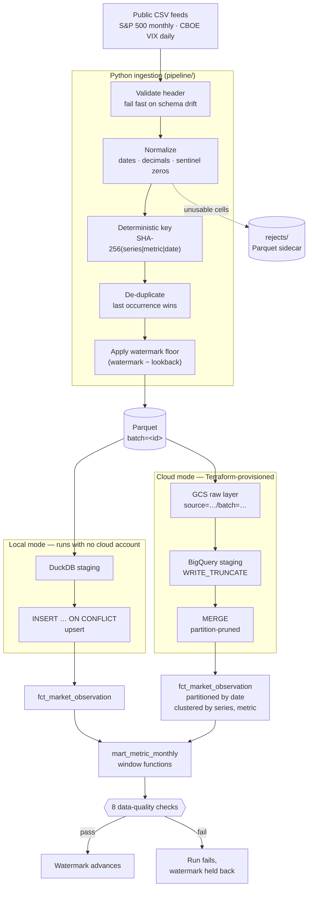

# terraform-gcp-data-pipeline

A reproducible batch data pipeline for public market data. Python ingests two
real public CSV feeds (S&P 500 monthly, CBOE VIX daily), normalizes them into
one canonical fact table, and loads them either into a local DuckDB warehouse
or into GCS + BigQuery provisioned by Terraform.

**Verified locally:** 114 tests, eight data-quality checks, 53,513 observations
processed, full re-process fingerprint identical (zero inserted, zero updated).

**Cloud infrastructure:** Terraform provisions bucket, BigQuery dataset with
partition- and cluster-optimized tables, least-privilege service account IAM,
and cost controls. Terraform `validate` passes in CI; GCP deployment is not run.

**Key design:** Deterministic SHA-256 business keys ensure idempotent
re-ingestion. Watermark + revision lookback catches corrections without
duplicating. Unchanged rows skip the upsert entirely so `updated_at` stays
stable. Quality checks must pass before the watermark advances.

> **Honest status.** Everything local is executed and verified: Python
> ingestion, DuckDB transformation, SQL checks, and fingerprint validation.
> **No GCP resources have been created and BigQuery SQL has never executed** —
> no credentials were configured and no cloud deployment was approved. The
> Terraform code is formatted, linted, and security-scanned. See
> [`docs/VERIFICATION.md`](docs/VERIFICATION.md) for complete test output.

---

## CI Status


---

## Architecture



The watermark advances **only after** the quality checks pass, so a failed run
is retried from the same position instead of silently skipping data.

**Crash-safe, bounded raw CSV ingestion.** HTTP downloads are streamed
in chunks with a 20 MiB transfer cap, staged in unique sibling files, flushed
and synchronized before atomic replacement. Oversized, empty, interrupted,
or failed downloads preserve the previous raw snapshot. Offline regression
tests cover the byte-limit boundary, early termination, HTTP errors, disk
failures, and exact-byte publication. The transfer cap bounds downloaded bytes,
not downstream parser memory; CSV schema validation occurs during ingestion.
This is local filesystem durability, not an end-to-end cloud transaction.

## Quickstart

```bash
git clone https://github.com/koushikchowdary6/terraform-gcp-data-pipeline.git
cd terraform-gcp-data-pipeline

python -m venv .venv && source .venv/bin/activate
pip install -r requirements-dev.txt

make run        # download both feeds, build the DuckDB warehouse, run checks
make rerun      # run again — proves nothing duplicates
make test       # 114 tests
make examples   # analytical queries against the result
```

`make run` takes a few seconds and needs no cloud account. Expected output is in
[`docs/VERIFICATION.md`](docs/VERIFICATION.md).

No network? Download the two CSVs listed in
[`docs/DATASETS.md`](docs/DATASETS.md) into `data/raw/` and use
`python -m pipeline.cli run-local --offline`.

## What actually ran

| Check | Tool | Result |
|---|---|---|
| Unit tests | pytest 9.1.1 | **114 passed** |
| Delivery regression tests | pytest 9.1.1 | **12 passed** (cloud batch delivery tracking) |
| Lint + format | ruff 0.17.0 | **clean** (126 source files) |
| Terraform format + syntax | OpenTofu 1.8.5 `fmt -check` | **clean** |
| Terraform lint | tflint 0.53.0 | **no findings** |
| Terraform security | checkov 3.3.29 | **12 passed, 0 failed, 4 accepted** |
| Real data loaded | DuckDB 1.5.6 | **53,513 observations** (11,147 rows) |
| Data-quality checks | SQL | **8/8 pass** |
| Re-process all rows | DuckDB | **0 inserted, 0 updated, fingerprint identical** |
| `terraform validate` | CI (provider schema) | **passes** |
| GCP deployment | — | **not performed** |
| BigQuery SQL execution | — | **not executed** |

## Data model

One long-format grain carries both feeds despite their different shapes:

```
(series_id, metric_name, observation_date) -> metric_value
```

`fct_market_observation`

| Column | Type | Notes |
|---|---|---|
| `observation_key` | STRING | `SHA-256(series_id|metric_name|observation_date)`. The merge key. |
| `series_id` | STRING | `SP500_COMPOSITE`, `CBOE_VIX`. Clustering key. |
| `metric_name` | STRING | `close`, `index_level`, `cpi`, … Clustering key. |
| `observation_date` | DATE | Monthly feeds normalized to the 1st. Partition column. |
| `metric_value` | NUMERIC(20,6) | `NUMERIC`, not `FLOAT64` — no binary drift on money. |
| `source_name`, `batch_id`, `ingested_at` | — | Lineage: which feed and which run wrote the row. |
| `updated_at` | TIMESTAMP | Unchanged by a no-op rerun. |

`mart_metric_monthly` aggregates to series × metric × month with the month's
close, month-over-month change (`LAG`) and a trailing 12-month average
(windowed `AVG`).

Why long format rather than one wide table per feed: adding a third feed becomes
a declaration in `pipeline/sources.py`, not a schema migration, a new table and
a new set of SQL models.

## Design decisions worth questioning

**Deterministic keys instead of surrogate keys.** A sequence or UUID would make
every re-run produce new rows for observations already loaded. Hashing the
business key means re-ingestion lands on the same row, so the upsert can decide
whether anything genuinely changed. This is the single decision that makes
everything else idempotent.

**Watermark minus a lookback, not a strict `>` filter.** Published financial
series revise recently published values. A strict watermark filter would never
see those corrections. Re-reading a trailing window (default 7 days) catches
them, and is only safe *because* the keys are deterministic.

**Unchanged rows are not rewritten.** Both the DuckDB upsert and the BigQuery
MERGE exclude rows whose value matches, so `updated_at` is stable across no-op
runs. "No duplicates" is a weaker property than "nothing was touched"; the
fingerprint test in `docs/VERIFICATION.md` checks the stronger one.

**Sentinel zeros are treated as missing — per metric.** The S&P feed pads
not-yet-reported fundamentals with `0.0`. A CPI of zero is not an observation,
and loading it would corrupt every average that touched it. But zero *is*
meaningful for some measures, so the rule is declared per source and per metric
rather than globally. Full reasoning in [`docs/DATASETS.md`](docs/DATASETS.md).

**Terraform owns the durable tables; the pipeline owns only staging.** Table
schema, partitioning and clustering are reviewed in version control instead of
appearing as a side effect of a load job. Staging is ephemeral and truncated on
every run, so the pipeline creates it.

**Quality checks are SQL, not Python assertions.** The same predicates can be
pasted into a console to list the offending rows. Each check reports a count,
so a failure is immediately actionable.

**No module structure in the Terraform.** Two resources' worth of abstraction
would cost more to read than it saves. ~180 lines of flat HCL is the right size
here; modules earn their keep across several environments.

## Repository layout

```
pipeline/            ingestion, state, warehouse adapters, CLI
  sources.py         declarative feed specs (add a feed here)
  schema.py          validation, normalization, deterministic keys
  ingest.py          CSV -> validated observations -> Parquet
  state.py           watermark store and lookback window
  warehouse.py       DuckDB local warehouse
  bq.py  gcs.py      BigQuery and GCS adapters (lazy-imported)
  quality.py         runs the SQL checks and decides pass/fail
sql/duckdb/          staging, upsert, analytics, quality, examples
sql/bigquery/        the same four, in BigQuery dialect
terraform/           bucket, dataset, tables, service account, IAM
  schemas/*.json     BigQuery table schemas
tests/               114 tests, offline, deterministic fixtures
.github/workflows/   python.yml (lint, test, CLI smoke) · terraform.yml
docs/                DATASETS.md · VERIFICATION.md
```

## Cloud execution

Nothing below has been run. It is the documented path, not a report.

### Prerequisites

1. A GCP project with **billing enabled**.
2. `gcloud` and `terraform` (≥ 1.5) installed.
3. Credentials via ADC — no key file:
   ```bash
   gcloud auth application-default login
   gcloud config set project YOUR_PROJECT_ID
   ```
4. Permissions to create buckets, BigQuery datasets, service accounts and IAM
   bindings, plus `serviceusage.services.enable` if `enable_apis = true`.

### Provision

```bash
cd terraform
cp terraform.tfvars.example terraform.tfvars   # edit project_id
terraform init
terraform plan                                  # review before applying
terraform apply
eval "$(terraform output -raw pipeline_env)"     # exports GCP_* and BQ_*
```

### Run

```bash
python -m pipeline.cli run-local                 # produce a local batch first
python -m pipeline.cli estimate-cost             # dry-run byte estimate
python -m pipeline.cli run-cloud                 # upload, load, MERGE, verify
```

`estimate-cost` uses BigQuery's dry-run API, which reports bytes without
incurring charges. Run it before `run-cloud`.

### Expected cost

Small, but not zero — confirm against current pricing, these are estimates:

| Resource | Volume | Rough monthly cost |
|---|---|---|
| GCS standard storage | ~2 MB Parquet | far below $0.01 |
| BigQuery storage | ~5 MB | far below $0.01 |
| BigQuery queries | a few MB per run | first 1 TiB/month is free |
| Service accounts, IAM, API enablement | — | free |

The realistic risk is not this dataset but a careless query against a large
table later. `require_partition_filter = true` is the guard; it defaults to
`false` so whole-history aggregations still work.

### Teardown

```bash
cd terraform
terraform destroy
```

`deletion_protection` and `force_destroy` deliberately block destroying tables
with data and a non-empty bucket. To tear down completely, set both switches in
`terraform.tfvars`, apply once so the change registers, then destroy:

```hcl
table_deletion_protection = false
bucket_force_destroy      = true
```

```bash
terraform apply && terraform destroy
```

Then confirm nothing is left:

```bash
gcloud storage buckets list --filter="name:market-pipeline"
bq ls --project_id=YOUR_PROJECT_ID
```

## Troubleshooting

| Symptom | Cause and fix |
|---|---|
| `SchemaError: input is missing required column(s)` | Upstream changed its header. Compare against `metric_columns` in `pipeline/sources.py`. Intentional — silent column loss is worse. |
| `Data-quality failure: …` (exit 1) | A check failed and the watermark was held back. Open `sql/duckdb/04_quality.sql`, run the failing predicate as a `SELECT` to list the rows. |
| `Watermark file … is corrupt` | Delete `data/local/watermarks.json` to re-process from scratch; the upsert makes that safe. |
| `Could not download … Forbidden` | No outbound access. Fetch the CSVs by hand and use `--offline`. |
| `Configuration error: Missing required environment variable(s)` (exit 2) | A cloud command ran without `GCP_PROJECT_ID`/`GCS_BUCKET`. By design, nothing reaches the network before configuration is validated. |
| `Permission denied writing to gs://…` | The active identity lacks `roles/storage.objectAdmin` on the bucket. Terraform grants it to the pipeline service account; impersonate it, or add yourself to `pipeline_runner_members`. |
| `Required module 'pytz' failed to import` | DuckDB needs `pytz` to convert `TIMESTAMPTZ` to Python. The pipeline casts to text to avoid the dependency; `pip install pytz` if your own query hits it. |
| `terraform init` fails on provider download | Network or proxy blocking the registry — the exact problem hit while writing this. |

Exit codes: `0` success, `1` pipeline or data-quality failure, `2` configuration error.

## Known limitations

1. **No GCP deployment has happened.** The cloud path is unexecuted code.
2. **The BigQuery SQL is unproven.** It mirrors the DuckDB statements that do
   run and follows documented semantics, but MERGE behaviour and partition
   pruning have not been observed against the real engine.
3. **`terraform validate` does not run locally** (provider registry blocked),
   only in CI — where it passes. It caught a real bug the local tools could
   not; see `docs/VERIFICATION.md`.
4. **Single-machine, single-process.** Ingestion reads a whole CSV in one pass.
   Fine at ~10k rows; a feed in the millions wants chunked reads, and one in the
   billions wants a different tool.
5. **No orchestrator.** Scheduling is out of scope here by choice — the
   companion `airflow-postgres-etl` project covers that ground.
6. **Full-file reads every run.** Both feeds publish a single cumulative file,
   so the pipeline re-reads it and filters by watermark rather than fetching a
   delta. The upstream feeds offer no incremental endpoint.
7. **`DECIMAL(20,6)` is assumed sufficient.** A value needing more than 14
   integer digits would overflow.
8. **Local state.** The watermark is a JSON file and Terraform state is local.
   Neither is safe for concurrent runs; the BigQuery watermark table in
   `bq.py` is the multi-writer answer, and it is also unexecuted.

## Licence

Code: MIT ([`LICENSE`](LICENSE)). Both datasets are published under the Open
Data Commons PDDL; see [`docs/DATASETS.md`](docs/DATASETS.md).
